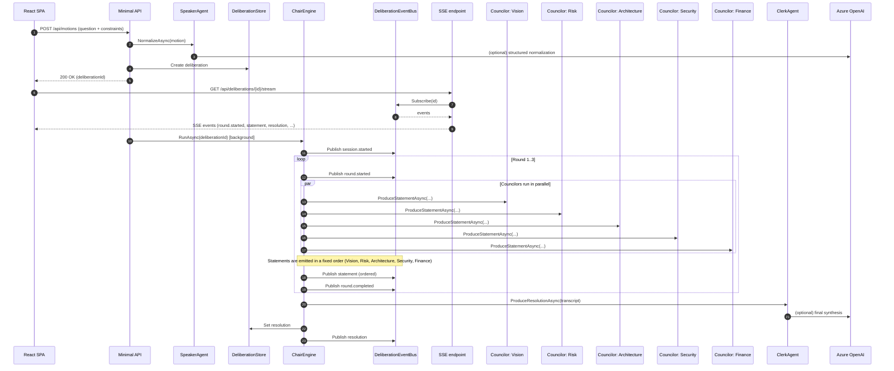

# AzureAICouncil

Azure AI Council is a deliberative, multi-agent decision system built with **.NET (Aspire + Minimal API)** and a **React/Vite** SPA.

It runs a 3-round “council” deliberation (parallel councilors, deterministic ordered emission), streams progress to the UI via **Server-Sent Events (SSE)**, and emits dev telemetry to the **.NET Aspire Dashboard (OpenTelemetry/OTLP)**.

## Repo layout

- `src/` – .NET projects
  - `AzureAiCouncil.AppHost` – Aspire AppHost (orchestrates local dev)
  - `AzureAiCouncil.ServiceDefaults` – shared Aspire/OpenTelemetry defaults
  - `AzureAiCouncil.Api` – Minimal API + SSE
  - `AzureAiCouncil.Core` – domain models + in-memory store/event bus + Chair orchestration
  - `AzureAiCouncil.Agents` – Speaker/Councilors/Clerk agents (Azure OpenAI + mock fallback)
- `tests/` – xUnit unit tests
- `web/azure-ai-council-spa/` – React/Vite UI

## Agents (Microsoft Agent Framework)

This project constructs and runs agents using the **Microsoft Agent Framework**:

- Upstream repo: https://github.com/microsoft/agent-framework
- Agent construction: `CreateAIAgent(...)` is called in `src/AzureAiCouncil.Agents/CouncilAgentFactory.cs`.
- Agent execution: agents are invoked via `ChatClientAgent.RunAsync(...)` from the role wrappers:
  - `src/AzureAiCouncil.Agents/CouncilorAgent.cs`
  - `src/AzureAiCouncil.Agents/ClerkAgent.cs`
  - `src/AzureAiCouncil.Agents/SpeakerAgent.cs`

### Agent roles

The council is intentionally split into role-focused agents so each one can optimize for a specific perspective:

- **Speaker** (`ISpeakerAgent`): normalizes the incoming motion (question + constraints) into a consistent internal shape before deliberation starts.
- **Councilors** (`ICouncilorAgent`): produce one structured statement per round. The built-in councilor roles are:
  - `Vision`: goals, outcomes, success criteria
  - `Risk`: risks, failure modes, mitigations
  - `Architecture`: design options, tradeoffs, implementation approach
  - `Security`: threats, controls, compliance considerations
  - `Finance`: cost drivers, budget fit, ROI considerations
- **Clerk** (`IClerkAgent`): synthesizes the full transcript into the final council resolution.

Orchestration is handled by the **Chair** (`ChairEngine` in `AzureAiCouncil.Core`): it runs 3 rounds, starts councilors in parallel, then emits their statements in a deterministic order.

If Azure OpenAI isn’t configured, the system falls back to **mock agents** (so the UI/SSE flow still works).

### Interaction diagram



## Prerequisites

- .NET SDK **10.0.404** (pinned via `global.json`; targets remain `net10.0`)
- Aspire CLI **17.0.0** and its matching dashboard/DCP bundle (required for AppHost builds/runs)
- Node.js **26.13.0** + npm **11.20.0** (for the SPA, after resolving the lockfile hold below)

### Dependency refresh status (2026-11-18)

Versions were verified through the configured approved NuGet feed
`https://packagefeedproxy.microsoft.io/nuget/v3/index.json`; GitHub Actions
versions were verified against each action's official stable release.

| Direct dependency | Before | After |
|---|---|---|
| Aspire AppHost | Aspire.AppHost.Sdk 13.1.0 | Microsoft.NET.Sdk + Aspire.Hosting.AppHost / Aspire.Hosting.Dotnet 17.0.0 |
| Microsoft.Agents.AI / Microsoft.Agents.AI.OpenAI | 1.0.0-preview.260108.1 | 1.28.0 stable |
| Microsoft.Extensions.AI / AI.OpenAI | 10.2.0 / 10.2.0-preview.1.26063.2 | 11.0.0 stable |
| Microsoft.Extensions configuration, DI, logging and options | 10.0.2 | 11.0.0 |
| Microsoft.Extensions.Http.Resilience / ServiceDiscovery | 10.1.0 | 11.0.0 |
| OpenAI | 2.8.0 | 2.15.0 |
| ASP.NET OpenAPI / MVC Testing | 10.0.2 | 10.0.15 |
| OpenTelemetry hosting, OTLP, ASP.NET, HTTP and runtime | 1.14.0 | 1.21.0 |
| Microsoft.NET.Test.Sdk / coverlet.collector | 17.14.1 / 6.0.4 | 18.12.0 / 10.1.0 |
| xunit / xunit.runner.visualstudio | 2.9.3 / 2.5.6 | 2.9.3 (newest stable) / 4.0.1 |
| actions/checkout / setup-dotnet | v4 / v4 | v7.0.1 / v6.1.0 |
| actions/setup-node / upload-artifact | v4 / v4 | v7.1.0 / v7.0.2 |

**Exact holds and unfinished work:**

- **Aspire 17 source migration is complete; signed-package validation is held.**
  The [official migration](https://aspire.dev/integrations/dotnet/migrate-dotnet-project-resource/)
  is implemented with `Microsoft.NET.Sdk`, explicit AppHost/Dotnet 17.0.0
  packages and path-based `AddDotnetProject` for `api` at
  `src\AzureAiCouncil.Api\AzureAiCouncil.Api.csproj`. Only its orchestration-only
  project reference was removed; UserSecretsId, default launch-profile selection,
  external endpoints, SPA executable, environment and URL wiring are unchanged.
  AppHost and consumers remain `net10.0`; service/library references remain.
  The approved-feed availability hold was not rescanned or bypassed with a
  public NuGet source. See the local-only evidence below.
- ASP.NET 11 targets only `net11.0`, so 10.0.15 is the newest compatible
  stable ASP.NET line. Extensions 11 packages explicitly support `net10.0`.
- **All npm ranges and the SPA lockfile are unchanged.** Offline inspection
  found **361** public-registry resolved URLs in
  `web/azure-ai-council-spa/package-lock.json`, despite the effective registry
  being `https://packagefeedproxy.microsoft.io/npm/`. Proxy metadata was
  checked, but no npm install/ci, build, lint or test was run. An authoritative
  proxy-only lockfile or explicit approval to regenerate it is needed before
  installing on this managed device. Never contact an unapproved registry or
  silently replace lockfile URLs. The npm commands below apply locally only
  after resolving this hold. Existing upstream CI installation behavior is
  preserved; canonical lockfile metadata alone does not establish the network
  route used by a correctly configured package manager.

The Agent Framework migration uses `AsAIAgent` and the `session` argument,
preserving tool invocation and per-call chat options. API test configuration
also overrides captured agent options so local user secrets cannot enable
real model calls in mock-mode tests.

### Aspire 17 local development / compile validation

The official GitHub Windows x64 CLI is
`17.0.0+2d325b13709752ba6d9a943635c5e2940a2530c0`; Authenticode and the SHA512
sidecar were verified (archive SHA256
`3d88b09be9cd3d344323b2e3531280954953581adb8102ad50eaf23c67007c05`).
Matching-commit 17.0.0 NuGets came from GitHub Actions run **44203911604**,
artifact **14382652960**, `built-nugets`, archive SHA256
`6e522a103ff37924122e9ebea3a8bf33f21b3349e11e0b59bc86ac51cc2a15aa`.
These are **unsigned Debug CI artifacts for LOCAL development/compile validation
only**, not proof of signed production release packages.

Restore used the external validation config's local `Aspire.*` source plus the
approved NuGet proxy, with isolated `NUGET_PACKAGES` at
`.tools\aspire17-release\validation-cache-azureaicouncil` in the upgrade workspace.
The released CLI directory was prepended to PATH for each command only, with
`ASPIRE_HOME` isolated to `home-azureaicouncil`; global packages were only read as
fallback dependencies. No global NuGet configuration, PATH, tool, SDK or workload
was changed. Workload-update notifications and first-time experience were disabled
through process-scoped environment variables.

**The development-only AppHost lock was removed from candidate changes.**
Unsigned Debug CI `.nupkg` content hashes **differ** from signed Release
packages with the same 17.0.0 IDs/versions; they are not portable signed-release
locks. The obsolete untracked 13.6.5 Windows/Linux locks were removed too.
No pre-existing tracked NuGet locks were found or changed; approved-feed locks
for other projects and lock-generation settings remain intact. The baseline
ordinary solution restore is preserved: no new whole-solution locked-mode gate
is enabled while the signed AppHost lock is unavailable. Signed-package release
acceptance remains pending normal feed availability. Generate and review any
future release lock only from the actual signed 17.0.0 packages; never ignore
hash mismatches, substitute development hashes, or publish local CI artifacts.
Future local validation must keep development-only locks outside candidate
changes. No machine-absolute
source or expiring artifact download URL is committed. CI must also provision
the matching released Aspire CLI 17 bundle before building the AppHost.

With `-m:1 -nr:false`, the AppHost builds with **zero warnings/errors**, including
no legacy API/SDK warnings. Windows and Linux-host-property locked restores used
the same **development-only** lock, subsequently removed; they do not establish
signed-release lock validity. Focused API regressions passed **8/8** in mock mode, rebuilding
the API, Agents, Core and ServiceDefaults. Earlier dependency-refresh validation
passed the solution build and **119** backend tests with coverage; that is an
earlier full-suite result, not a new Aspire 17 full-suite run. No AppHost/server,
browser, container, publishing, deployment or CI run was launched. Publishing is
unverified; validate with `aspire publish` when authorized, not legacy
`dotnet run --operation publish`. The npm hold remains in force.

## Quickstart (dev)

1) Start the Aspire app host:

```bash
dotnet run --project src/AzureAiCouncil.AppHost
```

2) Start the SPA:

```bash
cd web/azure-ai-council-spa
npm install
npm run dev
```

3) Open the SPA (default Vite URL):

- `http://localhost:5173`

The SPA calls the API at `http://localhost:5139` by default.

## Azure OpenAI configuration (optional)

If Azure OpenAI isn’t configured, the system runs in **mock agent mode** (useful for UI/dev flows).

To enable real deliberation, configure these settings for the API:

- `AzureOpenAI:Endpoint` (e.g. `https://YOUR-RESOURCE-NAME.openai.azure.com/`)
- `AzureOpenAI:ApiKey`
- `AzureOpenAI:Deployment`

Recommended: use **dotnet user-secrets** so you don’t commit keys.

```bash
dotnet user-secrets init --project src/AzureAiCouncil.Api
dotnet user-secrets set "AzureOpenAI:Endpoint" "https://YOUR-RESOURCE-NAME.openai.azure.com/" --project src/AzureAiCouncil.Api
dotnet user-secrets set "AzureOpenAI:ApiKey" "<YOUR-KEY>" --project src/AzureAiCouncil.Api
dotnet user-secrets set "AzureOpenAI:Deployment" "YOUR-DEPLOYMENT-NAME" --project src/AzureAiCouncil.Api
```

Environment variables also work:

- `AzureOpenAI__Endpoint`
- `AzureOpenAI__ApiKey`
- `AzureOpenAI__Deployment`

## Observability (Aspire)

When running via `AzureAiCouncil.AppHost`, services are wired for OpenTelemetry and should appear in the Aspire dashboard (logs/traces/metrics) automatically.

## API

- `POST /api/motions` – create a motion and start deliberation in the background
- `GET /api/deliberations/{id}` – fetch current deliberation snapshot
- `GET /api/deliberations/{id}/stream` – SSE stream of events

SSE event names:

- `stream.ready`
- `session.started`
- `round.started`
- `councilor.status`
- `statement`
- `round.completed`
- `resolution`
- `error`

## Tests

```bash
dotnet test tests/AzureAiCouncil.Tests/AzureAiCouncil.Tests.csproj
```

SPA tests:

```bash
cd web/azure-ai-council-spa
npm test
```

## Notes

- Secrets: do not commit API keys. Prefer user-secrets or environment variables.
- Streaming: SSE is the v1 transport; SignalR can be added later if desired.

## License

This project is licensed under the MIT License. See [LICENSE](LICENSE).
