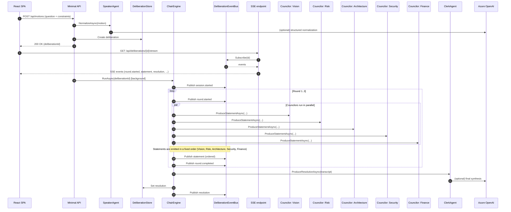

# AzureAICouncil

Azure AI Council is a deliberative, multi-agent decision system built with **.NET (Aspire + Minimal API)** and a **React/Vite** SPA.

It runs a 3-round “council” deliberation (parallel councilors, deterministic ordered emission), streams progress to the UI via **Server-Sent Events (SSE)**, and emits dev telemetry to the **.NET Aspire Dashboard (OpenTelemetry/OTLP)**.

## Repo layout

- `src/` – .NET projects
  - `AzureAiCouncil.AppHost` – Aspire AppHost (orchestrates local dev)
  - `AzureAiCouncil.ServiceDefaults` – shared Aspire/OpenTelemetry defaults
  - `AzureAiCouncil.Api` – Minimal API + SSE
  - `AzureAiCouncil.Core` – domain models + in-memory store/event bus + Chair orchestration
  - `AzureAiCouncil.Agents` – Speaker/Councilors/Clerk agents (Azure OpenAI + mock fallback)
- `tests/` – xUnit unit tests
- `web/azure-ai-council-spa/` – React/Vite UI

## Agents (Microsoft Agent Framework)

This project constructs and runs agents using the **Microsoft Agent Framework**:

- Upstream repo: https://github.com/microsoft/agent-framework
- Agent construction: `CreateAIAgent(...)` is called in `src/AzureAiCouncil.Agents/CouncilAgentFactory.cs`.
- Agent execution: agents are invoked via `ChatClientAgent.RunAsync(...)` from the role wrappers:
  - `src/AzureAiCouncil.Agents/CouncilorAgent.cs`
  - `src/AzureAiCouncil.Agents/ClerkAgent.cs`
  - `src/AzureAiCouncil.Agents/SpeakerAgent.cs`

### Agent roles

The council is intentionally split into role-focused agents so each one can optimize for a specific perspective:

- **Speaker** (`ISpeakerAgent`): normalizes the incoming motion (question + constraints) into a consistent internal shape before deliberation starts.
- **Councilors** (`ICouncilorAgent`): produce one structured statement per round. The built-in councilor roles are:
  - `Vision`: goals, outcomes, success criteria
  - `Risk`: risks, failure modes, mitigations
  - `Architecture`: design options, tradeoffs, implementation approach
  - `Security`: threats, controls, compliance considerations
  - `Finance`: cost drivers, budget fit, ROI considerations
- **Clerk** (`IClerkAgent`): synthesizes the full transcript into the final council resolution.

Orchestration is handled by the **Chair** (`ChairEngine` in `AzureAiCouncil.Core`): it runs 3 rounds, starts councilors in parallel, then emits their statements in a deterministic order.

If Azure OpenAI isn’t configured, the system falls back to **mock agents** (so the UI/SSE flow still works).

### Interaction diagram



## Prerequisites

- .NET SDK (repo is pinned via `global.json`)
- Node.js + npm (for the SPA)

## Quickstart (dev)

1) Start the Aspire app host:

```bash
dotnet run --project src/AzureAiCouncil.AppHost
```

2) Start the SPA:

```bash
cd web/azure-ai-council-spa
npm install
npm run dev
```

3) Open the SPA (default Vite URL):

- `http://localhost:5173`

The SPA calls the API at `http://localhost:5139` by default.

## Azure OpenAI configuration (optional)

If Azure OpenAI isn’t configured, the system runs in **mock agent mode** (useful for UI/dev flows).

To enable real deliberation, configure these settings for the API:

- `AzureOpenAI:Endpoint` (e.g. `https://YOUR-RESOURCE-NAME.openai.azure.com/`)
- `AzureOpenAI:ApiKey`
- `AzureOpenAI:Deployment`

Recommended: use **dotnet user-secrets** so you don’t commit keys.

```bash
dotnet user-secrets init --project src/AzureAiCouncil.Api
dotnet user-secrets set "AzureOpenAI:Endpoint" "https://YOUR-RESOURCE-NAME.openai.azure.com/" --project src/AzureAiCouncil.Api
dotnet user-secrets set "AzureOpenAI:ApiKey" "<YOUR-KEY>" --project src/AzureAiCouncil.Api
dotnet user-secrets set "AzureOpenAI:Deployment" "YOUR-DEPLOYMENT-NAME" --project src/AzureAiCouncil.Api
```

Environment variables also work:

- `AzureOpenAI__Endpoint`
- `AzureOpenAI__ApiKey`
- `AzureOpenAI__Deployment`

## Observability (Aspire)

When running via `AzureAiCouncil.AppHost`, services are wired for OpenTelemetry and should appear in the Aspire dashboard (logs/traces/metrics) automatically.

## API

- `POST /api/motions` – create a motion and start deliberation in the background
- `GET /api/deliberations/{id}` – fetch current deliberation snapshot
- `GET /api/deliberations/{id}/stream` – SSE stream of events

SSE event names:

- `stream.ready`
- `session.started`
- `round.started`
- `councilor.status`
- `statement`
- `round.completed`
- `resolution`
- `error`

## Tests

```bash
dotnet test tests/AzureAiCouncil.Tests/AzureAiCouncil.Tests.csproj
```

SPA tests:

```bash
cd web/azure-ai-council-spa
npm test
```

## Notes

- Secrets: do not commit API keys. Prefer user-secrets or environment variables.
- Streaming: SSE is the v1 transport; SignalR can be added later if desired.

## License

This project is licensed under the MIT License. See [LICENSE](LICENSE).
